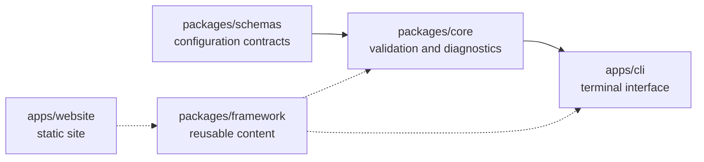
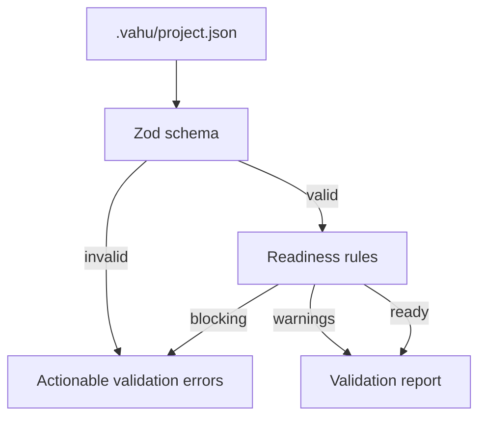

# Diagrams

## Phase 0 package graph

Solid arrows are runtime package dependencies. Dotted arrows mean content is
consumed without importing the CLI runtime. The framework must not depend on
the CLI.

## Configuration flow

The schema checks structure. Readiness checks relationships such as “a UI project
must have an approved design system.”
